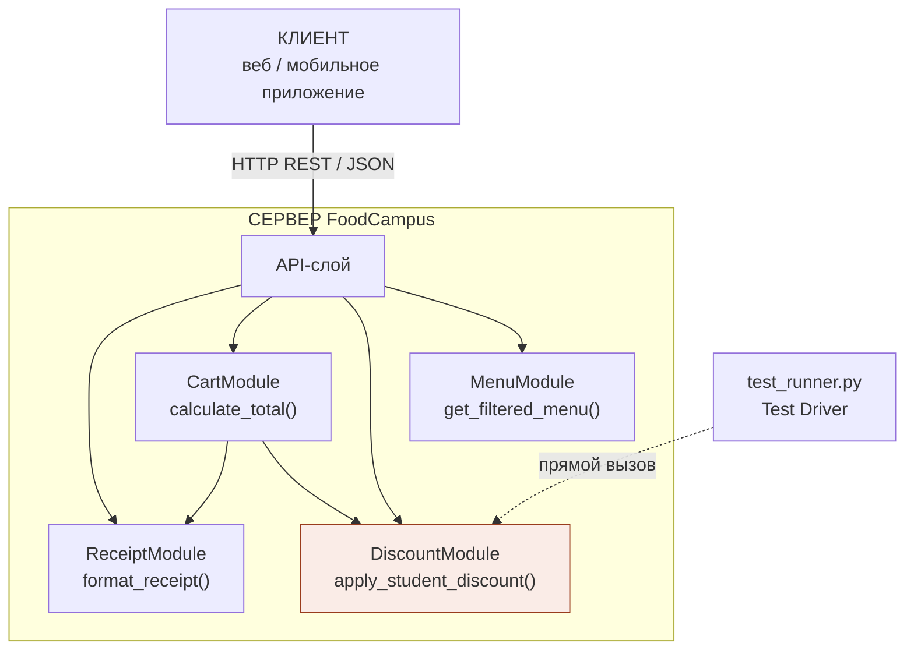
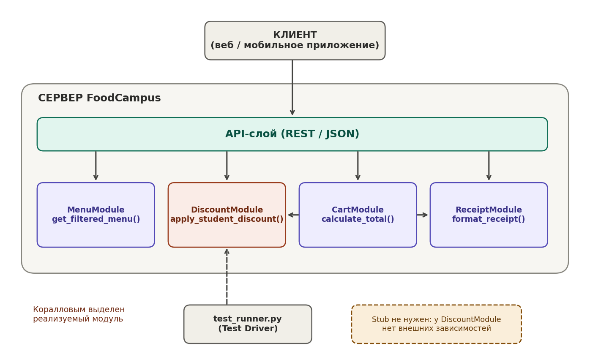
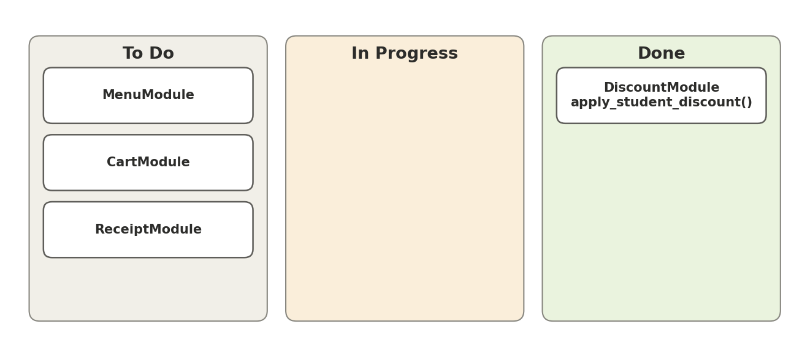

# FoodCampus — DiscountModule (Лаб. 3)

Практическое задание: реализация программного модуля по User Story и архитектуре.

- **Проект:** FoodCampus
- **Модуль:** `DiscountModule`
- **User Story:** «Как студент-льготник, я хочу подтвердить студбилет для получения скидки 15%.»
- **Интерфейс:** `apply_student_discount(card_id)`
- **Автор:** _ФИО, группа_

## Модульная архитектура (клиент-сервер)



Картинка: [docs/architecture.png](docs/architecture.png)



`DiscountModule` не зависит от других модулей, поэтому заглушка (Stub) не требуется.
Наоборот, `CartModule` обращается к `DiscountModule`.

## Спецификация метода

| | |
|---|---|
| Вход | `card_id` — номер студбилета, строка из ровно 8 цифр (0–9) |
| Выход | `{"valid": bool, "discount_percent": float, "message": str}` |
| Валидный билет | `valid=True`, `discount_percent=15.0` |
| Невалидный ввод | `valid=False`, `discount_percent=0.0`, `message` с причиной |
| Исключения | наружу не выбрасываются |

## Структура репозитория

```
├── discount_module.py     # код модуля
├── test_runner.py         # Test Driver (16 сценариев)
├── demo_bugs/             # первая (наивная) версия и скрипт, воспроизводящий баги
├── docs/                  # схема, канбан, вывод тестов
└── README.md              # отчёт
```

## Запуск

```bash
python test_runner.py
```

Ожидаемый итог: `Итого: 16 PASS, 0 FAIL`. Лог: [docs/test_output.txt](docs/test_output.txt).

Воспроизвести баги первой версии:

```bash
python demo_bugs/bug_probe.py
```

## Тестирование

| Группа | Сценарии |
|---|---|
| Позитивные | валидный билет; пробелы по краям; ведущие нули |
| Граничные | пустая строка; только пробелы; 7 и 9 цифр; `00000000` |
| Стресс-тест | текст, `None`, строка 5000 символов, число вместо строки, знак `+`, арабо-индийские цифры, SQL-инъекция, отрицательное |

## Bug Report

Найдены на первой версии (`demo_bugs/discount_v1_buggy.py`, реализация через `int(card_id)`).

| ID | Модуль и метод | Входные данные | Ожидаемый результат | Фактический результат | Статус |
|---|---|---|---|---|---|
| BUG-01 | DiscountModule.apply_student_discount | `"ABC-123"` | Сообщение о неверном формате | `ValueError`, падение | Исправлено |
| BUG-02 | DiscountModule.apply_student_discount | `None` | Сообщение «номер не указан» | `TypeError`, падение | Исправлено |
| BUG-03 | DiscountModule.apply_student_discount | строка из 5000 цифр | Отказ по длине | `ValueError` (лимит int), падение | Исправлено |
| BUG-04 | DiscountModule.apply_student_discount | `"+1234567"` | Отказ: только цифры | Скидка 15% выдана | Исправлено |
| BUG-05 | DiscountModule.apply_student_discount | `"١٢٣٤٥٦٧٨"` | Отказ | Скидка 15% выдана | Исправлено |

**Исправление:** `int()` заменён на `str.isdigit()` + `isascii()`, добавлены проверки на `None`, тип, пустую строку и длину.

## Канбан-доска



> Замените на скриншот своей доски (GitHub Projects) или добавьте ссылку: _ссылка_

## Чек-лист сдачи

- [x] Код модуля — `discount_module.py`
- [x] Тесты — `test_runner.py`
- [x] Bug Report (5 записей)
- [x] Схема архитектуры
- [ ] Скриншот или ссылка на Канбан с задачей в «Done»
